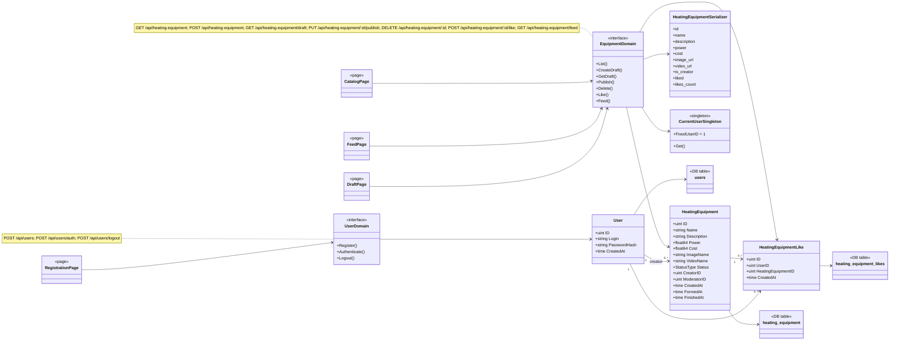

# Лабораторная работа №3 — веб-сервис отопительного оборудования

Проект переделан из ЛР2 в API для SPA. В ЛР3 сервер **не отдает HTML-шаблоны**: работа демонстрируется только через Postman/Insomnia. Все API-адреса начинаются с `/api`.

## Что реализовано

- REST API на Go + Gin.
- PostgreSQL через GORM.
- MinIO для изображения и короткого видео услуги.
- В БД хранятся только сгенерированные латинские имена файлов; сами файлы лежат в MinIO.
- Услуги имеют статусы `черновик`, `опубликован`, `удален`, но поле статуса **не отправляется клиенту**.
- Удаление только логическое (soft delete).
- В списке и ленте выдаются только опубликованные и не удаленные услуги.
- Один пользователь имеет не более одного черновика.
- Текущий пользователь для ЛР3 зафиксирован через singleton-функцию, `id = 1`.
- Системные поля (id, status, creator/moderator, даты) не принимаются от клиента.
- JSON успешных ответов не содержит служебных `status`, `message`, HTTP-кодов внутри тела.
- Ошибки возвращаются HTTP-кодом без пользовательских сообщений.
- Поля JSON услуги всегда одинаковые, даже если описание или числовое поле пустое.

## Быстрый запуск

Из корня проекта:

```bash
docker compose up -d
go mod tidy
go run ./cmd/migrate
go run ./cmd/awesomeProject
```

После запуска:

- API: `http://localhost:8080`
- MinIO API: `http://localhost:9000`
- MinIO Console: `http://localhost:9001`
- PostgreSQL: `localhost:5432`

MinIO bucket `heating-media` создается сервером автоматически и получает публичное чтение объектов, чтобы в следующей лабораторной SPA могла получать медиа по URL.

> Если после ЛР2 в БД уже остался старый черновик пользователя `id=1`, перед демонстрацией либо удалите его через API, либо выполните один раз SQL: `UPDATE heating_equipment SET status='удален', finished_at=NOW() WHERE creator_id=1 AND status='черновик';`.

## Postman

Готовая коллекция: `postman/Lab3.postman_collection.json`.

В ней **ровно 10 запросов** для показа. Для запроса `02 POST добавить услугу` выберите файлы:

- `postman/sample-image.png`
- `postman/sample-video.mp4`

Если Postman после импорта не подхватил относительный путь к файлу, просто нажмите **Select Files** и выберите эти два файла из папки `postman`.

Коллекция сама запоминает `equipmentId` после создания услуги.

## HTTP методы

В проекте реализовано **ровно 10 методов** по требованиям ЛР3: 7 методов домена услуги и 3 метода домена пользователя.

| № | Метод | URL | Что делает | Успех |
|---|---|---|---|---|
| 1 | GET | `/api/heating-equipment?name=&min_power=&max_cost=` | Список только опубликованных услуг с фильтрацией. В JSON есть `is_creator` 0/1 | 200 |
| 2 | GET | `/api/heating-equipment/feed` | Лента только опубликованных услуг. В JSON есть `liked` 0/1 для текущего пользователя | 200 / 404 |
| 3 | GET | `/api/heating-equipment/draft` | Единственный черновик текущего пользователя, id в URL не передается | 200 / 404 |
| 4 | POST | `/api/heating-equipment` | Создает черновик, принимает реальные файлы `image` и `video`, сохраняет их в MinIO | 201 |
| 5 | PUT | `/api/heating-equipment/:id/publish` | Публикует только черновик текущего пользователя | 200 / 404 |
| 6 | DELETE | `/api/heating-equipment/:id` | Soft delete, только услуга текущего пользователя | 200 / 404 |
| 7 | POST | `/api/heating-equipment/:id/like` | `{"like":1}` ставит лайк, `{"like":0}` снимает | 200 / 404 |
| 8 | POST | `/api/users` | Регистрация пользователя | 201 |
| 9 | POST | `/api/users/auth` | Заглушка аутентификации для ЛР4 | 200 |
| 10 | POST | `/api/users/logout` | Заглушка деавторизации для ЛР4 | 200 |

### Тело POST создания услуги

Тип запроса: `multipart/form-data`.

| Поле | Тип | Назначение |
|---|---|---|
| `name` | text | Название |
| `description` | text | Краткое описание |
| `power` | text/number | Мощность, кВт |
| `cost` | text/number | Стоимость, руб. |
| `image` | file | Изображение |
| `video` | file | Короткое видео |

Клиент **не передает** `id`, `status`, `creator_id`, `moderator_id`, `created_at`, `formed_at`, `finished_at`.

### Сериализованный JSON услуги

Для списка, черновика, публикации, ленты и лайка используется одна структура ответа:

```json
{
  "id": 12,
  "name": "Электрический котел 12 кВт",
  "description": "Компактный электрический котел для отопления дома",
  "power": 12,
  "cost": 58900,
  "image_url": "http://localhost:9000/heating-media/image_xxx.png",
  "video_url": "http://localhost:9000/heating-media/video_xxx.mp4",
  "is_creator": 1,
  "liked": 0,
  "likes_count": 0
}
```

`is_creator = 1`, когда создатель услуги совпадает с текущим пользователем. Поле `status` намеренно отсутствует в API и остается только в БД.

## Таблицы БД

### `users`

| Поле | Назначение |
|---|---|
| `id` | PK |
| `login` | уникальный логин |
| `password_hash` | хеш пароля |
| `created_at` | дата регистрации |

### `heating_equipment`

| Поле | Назначение |
|---|---|
| `id` | PK |
| `equipment_name` | название услуги |
| `short_description` | краткое описание |
| `power_kw` | мощность |
| `cost_rub` | стоимость |
| `image_name` | сгенерированное имя изображения в MinIO |
| `video_name` | сгенерированное имя видео в MinIO |
| `status` | черновик / опубликован / удален |
| `creator_id` | создатель |
| `moderator_id` | модератор, nullable |
| `created_at` | дата создания |
| `formed_at` | дата публикации |
| `finished_at` | дата завершения/удаления |

Для `status='черновик'` стоит частичный уникальный индекс по `creator_id`: у пользователя не может быть двух черновиков.

### `heating_equipment_likes`

| Поле | Назначение |
|---|---|
| `id` | PK |
| `user_id` | кто поставил лайк |
| `heating_equipment_id` | какой услуге |
| `created_at` | дата лайка |

Пара `(user_id, heating_equipment_id)` уникальна.

## Где показать модели, сериализаторы и singleton

**Модели:** `internal/app/model/heating.go`.

**Сериализатор:** `internal/app/serializer/heating_serializer.go`. Он отделяет структуру БД от JSON и гарантирует один и тот же набор полей ответа. Статус, создатель, модератор и системные даты не попадают в JSON.

**Singleton текущего пользователя:** `internal/app/currentuser/current_user.go`.

```go
const FixedUserID uint = 1

func Get() *User {
    once.Do(func() {
        instance = &User{ID: FixedUserID}
    })
    return instance
}
```

Использование видно в `internal/app/handler/heating_handler.go`, например при создании, получении черновика, публикации, лайке и удалении:

```go
currentuser.Get().ID
```

## SELECT для скриншотов 11–13

Открыть psql:

```bash
docker exec -it heating_postgres psql -U root -d mydb
```

### Скриншот 11 — услуги

```sql
SELECT id, equipment_name, short_description, power_kw, cost_rub,
       image_name, video_name, status, creator_id, moderator_id,
       created_at, formed_at, finished_at
FROM heating_equipment
ORDER BY id;
```

### Скриншот 12 — лайки

```sql
SELECT id, user_id, heating_equipment_id, created_at
FROM heating_equipment_likes
ORDER BY id;
```

### Скриншот 13 — пользователи

```sql
SELECT id, login, created_at
FROM users
ORDER BY id;
```

Выход из psql: `\q`.

## Порядок скриншотов для защиты

1. GET списка с фильтром (`min_power=100`).
2. GET ленты.
3. GET черновика.
4. POST добавления услуги с выбранными `image` и `video`.
5. PUT публикации.
6. DELETE soft delete.
7. POST like с `{"like":1}` или `{"like":0}`.
8. POST регистрации нового пользователя.
9. POST аутентификации — заглушка ЛР4.
10. POST деавторизации — заглушка ЛР4.
11. SELECT `heating_equipment`.
12. SELECT `heating_equipment_likes`.
13. SELECT `users`.
14. Модели в `internal/app/model/heating.go`.
15. Сериализатор в `internal/app/serializer/heating_serializer.go`.
16. Singleton `currentuser.Get()` и места его использования в handler.
17. README с HTTP-методами и таблицами.

## Диаграмма классов

Исходник диаграммы лежит в `docs/class-diagram.mmd`. Она содержит:

- два домена API (`heating-equipment`, `users`) и все 10 методов;
- модели `HeatingEquipment`, `HeatingEquipmentLike`, `User`;
- три таблицы БД;
- сериализатор;
- singleton текущего пользователя;
- четыре страницы будущего SPA: **Каталог**, **Лента**, **Создание/черновик**, **Регистрация**;
- зависимости страниц от доменов и доменов от моделей/таблиц.



## Тесты

```bash
go test ./...
```

Проверяются, в частности, singleton текущего пользователя, постоянный набор JSON-полей сериализатора, флаги `is_creator/liked`, разбор id и проверка типа загружаемого файла.
